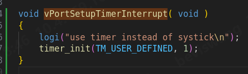
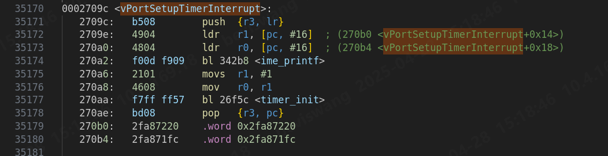
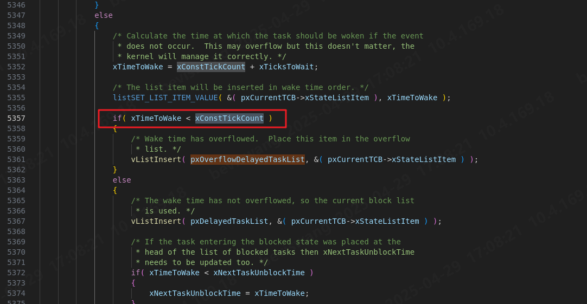
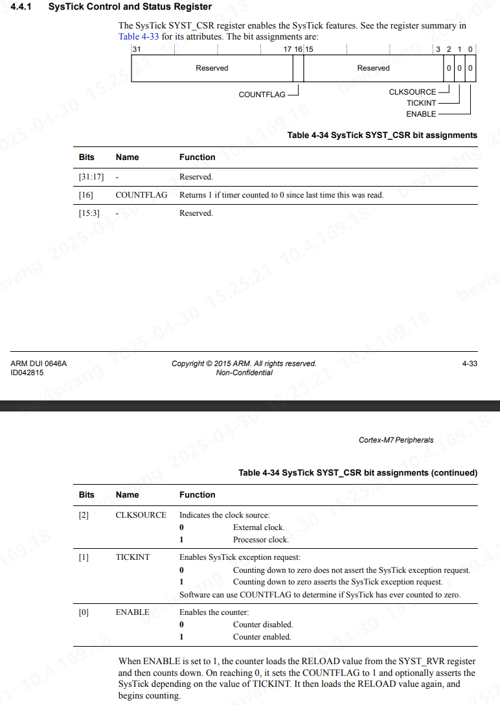

> FreeRTOS schdule及系统节拍相关

## 1 BG

FreeRTOS默认使用systick作为系统节拍，一般设置为1ms一次，改系统节拍用于task调度等。在自己做的项目中，采用默认的systick作为FreeRTOS的系统节拍，且**systick未配置为External Clock**，仅能使用Processor Clock。

但是在多master的角度，cpu的main\_clk和voltage调整是由一个特定的scp来做的，就会导致时钟切换和当前cpu收到notify是异步的。在两个节点之间，FreeRTOS整个工作都多多少少存在一些异常。例如：

1. timestamp问题
   我自己所做工作对时间戳有比较高的要求，但当前cpu并不像A核或者像vdsp等有RTC的访问权限，只能隔一段时间从APCPU发送mailbox msg用以sync时间戳，然后通过systick用以本地更新。但在切换当前cpu的mainclk且还未收到通知时，实际clk与systick配置的差异导致时间戳更新的飞快，然后等APCPU sync时间戳，会产生较大的时间戳回退。
2. delay问题
   虽然`vTaskDelay()`函数强调了并不能提供一个精准的延时，但在task的具体业务，或者某个driver中，还是经常能被用到。同样的，当在切换当前cpu的mainclk且还未收到通知时，delay会出现较大的误差，导致业务流程产生问题。

## 2 tick中断设置

### 2.1 中断源修改

`freertos/portable/GCC/ARM_CM7/r0p1/port.c`中的函数`vPortSetupTimerInterrupt`

```c
/*
* Setup the systick timer to generate the tick interrupts at the required
* frequency.
*/
__attribute__( ( weak ) ) void vPortSetupTimerInterrupt( void )
{
/* Calculate the constants required to configure the tick interrupt. */
#if ( configUSE_TICKLESS_IDLE == 1 )
{
ulTimerCountsForOneTick = ( configSYSTICK_CLOCK_HZ / configTICK_RATE_HZ );
xMaximumPossibleSuppressedTicks = portMAX_24_BIT_NUMBER / ulTimerCountsForOneTick;
ulStoppedTimerCompensation = portMISSED_COUNTS_FACTOR / ( configCPU_CLOCK_HZ / configSYSTICK_CLOCK_HZ );
}
#endif /* configUSE_TICKLESS_IDLE */
/* Stop and clear the SysTick. */
portNVIC_SYSTICK_CTRL_REG = 0UL;
portNVIC_SYSTICK_CURRENT_VALUE_REG = 0UL;
/* Configure SysTick to interrupt at the requested rate. */
portNVIC_SYSTICK_LOAD_REG = ( configSYSTICK_CLOCK_HZ / configTICK_RATE_HZ ) - 1UL;
portNVIC_SYSTICK_CTRL_REG = ( portNVIC_SYSTICK_CLK_BIT | portNVIC_SYSTICK_INT_BIT | portNVIC_SYSTICK_ENABLE_BIT );
}
```

该函数的调用pipeLine为`vTaskStartScheduler()` → `xPortStartScheduler()` → `vPortSetupTimerInterrupt()`，作用是配置systick中断，`portNVIC_SYSTICK_LOAD_REG`配置count计数，`portNVIC_SYSTICK_CTRL_REG`是systick中断control寄存器，可以配置使用mainclk或外部时钟。
`configUSE_TICKLESS_IDLE`宏用以开启`TICKLESS_MODE`，后续即配置Systick中断的频率。

同时，该函数被标记为weak，`__attribute__( ( weak ) )` ，表明该函数是可以被强符号函数覆盖掉。如果在使用场景中，运行 FreeRTOS的cpu的频率并非固定不变（存在dvfs等），实现同步重新配置systick寄存器难以实现或者比较复杂，可以尝试使用一个外部固定时钟源来确保系统运行的稳定。

下面两张图是使用外部timer来实现的vPortSetupTimerInterrupt ，汇编中能够看到该函数已经被覆盖。



### 2.2 irq handler修改

在Section 2.1重新设置了系统节拍的中断，需要同时修改当前中断的handler，使FreeRTOS能够正常调用

```c
extern void xPortSysTickHandler( void );
void TIMER_IRQHandler(void)
{
TIMER timer = {0};
timer.TimerNIntStatus_REG.value = readw(TIMER_N_INT_STATUS_REG_ADDR);
timer.TimersIntStatus_REG.value = readw(TIMERS_INT_STATUS_REG_ADDR);
timer.TimersEOI_REG.value = readw(TIMERS_EOI_REG_ADDR); // read clear above 2 reg bit
xPortSysTickHandler();
g_irq_cnt++;
}
```

在hw\_timer进行常规的清理中断之后，调用`xPortSysTickHandler()`

## 3 `xPortSysTickHandler()`

source code:

```c
void xPortSysTickHandler( void )
{
/* The SysTick runs at the lowest interrupt priority, so when this interrupt
* executes all interrupts must be unmasked. There is therefore no need to
* save and then restore the interrupt mask value as its value is already
* known. */
portDISABLE_INTERRUPTS();
{
/* Increment the RTOS tick. */
if( xTaskIncrementTick() != pdFALSE )
{
/* A context switch is required. Context switching is performed in
* the PendSV interrupt. Pend the PendSV interrupt. */
portNVIC_INT_CTRL_REG = portNVIC_PENDSVSET_BIT;
}
}
portENABLE_INTERRUPTS();
}
```

首先是关闭中断，因为系统节拍中断的优先级通常设置的比较低，为了防止handler被打断。

`xTaskIncrementTick()` 为系统节拍中断的**核心函数**，当其`ret==pdTRUE` 时，触发PendSV中断，进行task的上下文切换，该部分的详细流程**待补充**。

当`ret==pdFalse` 表示不需要进行切换，接下来分析`xTaskIncrementTick()`

### 3.1 `xTaskIncrementTick()`

### 

1. `xTickCount`

   * `uxSchedulerSuspended`

     首先是FreeRTOS中的静态变量`uxSchedulerSuspended` ，该变量在调用`vTaskSuspendAll()`时会自增1，表示调度器被挂起，调用`vTaskResumeAll()`函数时会自减1。该处仅讨论调度器未被挂起时的情况，即`uxSchedulerSuspended == ( UBaseType_t ) pdFALSE` 。
   * `xTickCount`
     该val定义如下：

     ```c
     #if( configUSE_16_BIT_TICKS == 1 )
     typedef uint16_t TickType_t;
     #define portMAX_DELAY ( TickType_t ) 0xffff
     #else
     typedef uint32_t TickType_t;
     #define portMAX_DELAY ( TickType_t ) 0xffffffffUL
     #endif
     PRIVILEGED_DATA static volatile TickType_t xTickCount = ( TickType_t ) configINITIAL_TICK_COUNT;
     ```

   可以看到在32位平台上，该变量默认位32位，最大值为`0xffffffffUL` ，在1ms一次tick的情况下，大约在1193h后tick就会溢出，溢出判断为`xConstTickCount == ( TickType_t ) 0U` 具体的处理在之后补充。
2. delay task处理

   随后比较当前tick和`xNextTaskUnblockTime` ，FreeRTOS中维护了delay task list，即`pxDelayedTaskList` ，在task中调用延时函数（如`vTaskDelay()`）之后，会调用`prvAddCurrentTaskToDelayedList()` 将该task TCB中的list插入到delay task list（类似于Linux内核链表），`xNextTaskUnblockTime` 即为该list中，最早需要被唤醒的task。

   如果该list非空，去除已经超时task的TCB，再进行一次判断确定超时之后，将该task从`pxDelayedTaskList` 中移除，同时将该task状态置为ready，插入ready list `pxReadyTasksLists` ，如果该task的优先级>当前正在运行的task优先级 且 开启抢占，将返回值置为`pdTRUE` 进行调度。
3. 后续处理

   时间片切片的处理，相同优先级task共享时间片；

   Tick的钩子函数等
4. source code

   ```c
   BaseType_t xTaskIncrementTick( void )
   {
   TCB_t * pxTCB;
   TickType_t xItemValue;
   BaseType_t xSwitchRequired = pdFALSE;
   /* Called by the portable layer each time a tick interrupt occurs.
   * Increments the tick then checks to see if the new tick value will cause any
   * tasks to be unblocked. */
   traceTASK_INCREMENT_TICK( xTickCount );
   if( uxSchedulerSuspended == ( UBaseType_t ) pdFALSE )
   {
   /* Minor optimisation. The tick count cannot change in this
   * block. */
   const TickType_t xConstTickCount = xTickCount + ( TickType_t ) 1;
   /* Increment the RTOS tick, switching the delayed and overflowed
   * delayed lists if it wraps to 0. */
   xTickCount = xConstTickCount;
   if( xConstTickCount == ( TickType_t ) 0U ) /*lint !e774 'if' does not always evaluate to false as it is looking for an overflow. */
   {
   taskSWITCH_DELAYED_LISTS();
   }
   else
   {
   mtCOVERAGE_TEST_MARKER();
   }
   /* See if this tick has made a timeout expire. Tasks are stored in
   * the queue in the order of their wake time - meaning once one task
   * has been found whose block time has not expired there is no need to
   * look any further down the list. */
   if( xConstTickCount >= xNextTaskUnblockTime )
   {
   for( ; ; )
   {
   if( listLIST_IS_EMPTY( pxDelayedTaskList ) != pdFALSE )
   {
   /* The delayed list is empty. Set xNextTaskUnblockTime
   * to the maximum possible value so it is extremely
   * unlikely that the
   * if( xTickCount >= xNextTaskUnblockTime ) test will pass
   * next time through. */
   xNextTaskUnblockTime = portMAX_DELAY; /*lint !e961 MISRA exception as the casts are only redundant for some ports. */
   break;
   }
   else
   {
   /* The delayed list is not empty, get the value of the
   * item at the head of the delayed list. This is the time
   * at which the task at the head of the delayed list must
   * be removed from the Blocked state. */
   pxTCB = listGET_OWNER_OF_HEAD_ENTRY( pxDelayedTaskList ); /*lint !e9079 void * is used as this macro is used with timers and co-routines too. Alignment is known to be fine as the type of the pointer stored and retrieved is the same. */
   xItemValue = listGET_LIST_ITEM_VALUE( &( pxTCB->xStateListItem ) );
   if( xConstTickCount < xItemValue )
   {
   /* It is not time to unblock this item yet, but the
   * item value is the time at which the task at the head
   * of the blocked list must be removed from the Blocked
   * state - so record the item value in
   * xNextTaskUnblockTime. */
   xNextTaskUnblockTime = xItemValue;
   break; /*lint !e9011 Code structure here is deemed easier to understand with multiple breaks. */
   }
   else
   {
   mtCOVERAGE_TEST_MARKER();
   }
   /* It is time to remove the item from the Blocked state. */
   listREMOVE_ITEM( &( pxTCB->xStateListItem ) );
   /* Is the task waiting on an event also? If so remove
   * it from the event list. */
   if( listLIST_ITEM_CONTAINER( &( pxTCB->xEventListItem ) ) != NULL )
   {
   listREMOVE_ITEM( &( pxTCB->xEventListItem ) );
   }
   else
   {
   mtCOVERAGE_TEST_MARKER();
   }
   /* Place the unblocked task into the appropriate ready
   * list. */
   prvAddTaskToReadyList( pxTCB );
   /* A task being unblocked cannot cause an immediate
   * context switch if preemption is turned off. */
   #if ( configUSE_PREEMPTION == 1 )
   {
   /* Preemption is on, but a context switch should
   * only be performed if the unblocked task has a
   * priority that is equal to or higher than the
   * currently executing task. */
   if( pxTCB->uxPriority >= pxCurrentTCB->uxPriority )
   {
   xSwitchRequired = pdTRUE;
   }
   else
   {
   mtCOVERAGE_TEST_MARKER();
   }
   }
   #endif /* configUSE_PREEMPTION */
   }
   }
   }
   /* Tasks of equal priority to the currently running task will share
   * processing time (time slice) if preemption is on, and the application
   * writer has not explicitly turned time slicing off. */
   #if ( ( configUSE_PREEMPTION == 1 ) && ( configUSE_TIME_SLICING == 1 ) )
   {
   if( listCURRENT_LIST_LENGTH( &( pxReadyTasksLists[ pxCurrentTCB->uxPriority ] ) ) > ( UBaseType_t ) 1 )
   {
   xSwitchRequired = pdTRUE;
   }
   else
   {
   mtCOVERAGE_TEST_MARKER();
   }
   }
   #endif /* ( ( configUSE_PREEMPTION == 1 ) && ( configUSE_TIME_SLICING == 1 ) ) */
   #if ( configUSE_TICK_HOOK == 1 )
   {
   /* Guard against the tick hook being called when the pended tick
   * count is being unwound (when the scheduler is being unlocked). */
   if( xPendedTicks == ( TickType_t ) 0 )
   {
   vApplicationTickHook();
   }
   else
   {
   mtCOVERAGE_TEST_MARKER();
   }
   }
   #endif /* configUSE_TICK_HOOK */
   #if ( configUSE_PREEMPTION == 1 )
   {
   if( xYieldPending != pdFALSE )
   {
   xSwitchRequired = pdTRUE;
   }
   else
   {
   mtCOVERAGE_TEST_MARKER();
   }
   }
   #endif /* configUSE_PREEMPTION */
   }
   else
   {
   ++xPendedTicks;
   /* The tick hook gets called at regular intervals, even if the
   * scheduler is locked. */
   #if ( configUSE_TICK_HOOK == 1 )
   {
   vApplicationTickHook();
   }
   #endif
   }
   return xSwitchRequired;
   }
   ```

## 4 FreeRTOS tickcount溢出处理

上文提到了FreeRTOSS的`xTickCount` 类型是32bit的，按照1ms一次tick中断，大约在50天后就会溢出，FreeRTOS对tick cnt溢出做了处理。

FreeRTOS会创建两个delay相关的task：

```c
PRIVILEGED_DATA static List_t * volatile pxDelayedTaskList; /*< Points to the delayed task list currently being used. */
PRIVILEGED_DATA static List_t * volatile pxOverflowDelayedTaskList; /*< Points to the delayed task list currently being used to hold tasks that have overflowed the current tick count. */
```

`pxDelayedTaskList`中维护调用了延时接口的task，其中到期时间并不会溢出；如果到期时间已经发生溢出，将该task添加至`pxOverflowDelayedTaskList`



下面是`xTaskIncrementTick()` 的溢出判断

```c
if( xConstTickCount == ( TickType_t ) 0U ) /*lint !e774 'if' does not always evaluate to false as it is looking for an overflow. */
{
taskSWITCH_DELAYED_LISTS();
}
else
{
mtCOVERAGE_TEST_MARKER();
}
```

当`xConstTickCount==0` 时，即已经发生溢出，调用`taskSWITCH_DELAYED_LISTS();`

该宏的具体实现如下：

```c
/* pxDelayedTaskList and pxOverflowDelayedTaskList are switched when the tick
* count overflows. */
#define taskSWITCH_DELAYED_LISTS() \
{ \
List_t * pxTemp; \
\
/* The delayed tasks list should be empty when the lists are switched. */ \
configASSERT( ( listLIST_IS_EMPTY( pxDelayedTaskList ) ) ); \
\
pxTemp = pxDelayedTaskList; \
pxDelayedTaskList = pxOverflowDelayedTaskList; \
pxOverflowDelayedTaskList = pxTemp; \
xNumOfOverflows++; \
prvResetNextTaskUnblockTime(); \
}
```

即当发生溢出后，将`pxOverflowDelayedTaskList` 和`pxDelayedTaskList` 进行置换，这样能够保证`vTaskDelay()` ，但我认为可以直接将`pxOverflowDelayedTaskList` 清空，因为在task调用延时函数时，已经对溢出做了判断，当前`pxDelayedTaskList` 不应有为被调起的task。

## 5 Apendix

上述问题的前提为无稳定的外部时钟源可选的无奈之举，如果Systick外部有稳定时钟源可选的话，就不存在上述问题，同时，上述对节拍器中断源的重新配置，会导致FreeRTOS原生的tick less mode无法使用（很难适配）。

若有稳定的systick外部时钟，下面是配置方式。

1. 首先是systick control寄存器描述：
   
2. 仅需在`FreeRTOSConfig.h` 添加SysTick clock的参数即可，`vPortSetupTimerInterrupt` 函数中的宏定义`portNVIC_SYSTICK_CLK_BIT` 和`configSYSTICK_CLOCK_HZ` 也会随之修改，
   然后在FreeRTOS初始化Systick时，配置`SYST_CSR`寄存器。

   ```c
   #define configSYSTICK_CLOCK_HZ 32768
   __attribute__( ( weak ) ) void vPortSetupTimerInterrupt( void )
   {
   /* Calculate the constants required to configure the tick interrupt. */
   #if ( configUSE_TICKLESS_IDLE == 1 )
   {
   ulTimerCountsForOneTick = ( configSYSTICK_CLOCK_HZ / configTICK_RATE_HZ );
   xMaximumPossibleSuppressedTicks = portMAX_24_BIT_NUMBER / ulTimerCountsForOneTick;
   ulStoppedTimerCompensation = portMISSED_COUNTS_FACTOR / ( configCPU_CLOCK_HZ / configSYSTICK_CLOCK_HZ );
   }
   #endif /* configUSE_TICKLESS_IDLE */
   /* Stop and clear the SysTick. */
   portNVIC_SYSTICK_CTRL_REG = 0UL;
   portNVIC_SYSTICK_CURRENT_VALUE_REG = 0UL;
   /* Configure SysTick to interrupt at the requested rate. */
   portNVIC_SYSTICK_LOAD_REG = ( configSYSTICK_CLOCK_HZ / configTICK_RATE_HZ ) - 1UL;
   portNVIC_SYSTICK_CTRL_REG = ( portNVIC_SYSTICK_CLK_BIT | portNVIC_SYSTICK_INT_BIT | portNVIC_SYSTICK_ENABLE_BIT );
   }
   ```
