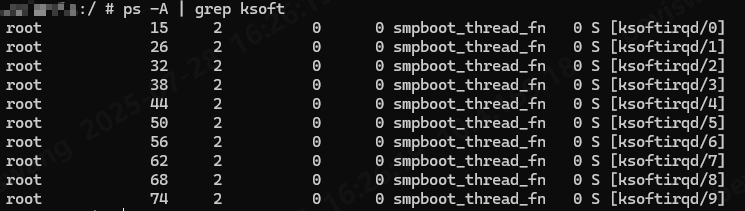
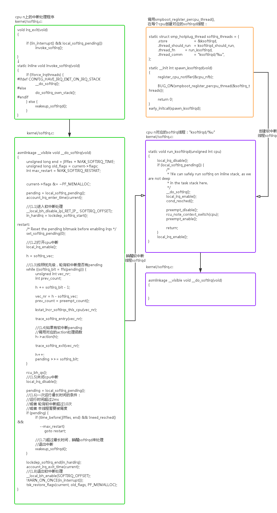

> Introduction for Softirq and Tasklets of the Linux kernel

## 1 BG

计算机设备中，外设的速度是远低于cpu的计算速度的，一般采用中断这种异步方式来进行时间通知。

在整个中断处理过程中，arm64 的 CPU 全局中断是自动 disable 的 (PSTATE 寄存器中的 interrupt bit 被 masks)。如果用户想支持 interrupt nested，需要自己在中断服务程序中使能中断。Linux 现在是不使用中断嵌套的。

这就需要保证中断的isr需要尽可能短，将非紧急但很占用时间的具体操作延后。即所谓的**defered interrupt或**中断下半部。

这里不关注Arm的中断触发到处理流程，仅记录两种defered interrupt的方式：softirq和tasklet

## 2 Software Interrupts

### 1 init

当前内核中softirq有9个，均是静态分配。

其中两个用来实现tasklet（`HI_SOFTIRQ`和`TASKLET_SOFTIRQ`），两个用于网络的发送和接收操作（`NET_TX_SOFTIRQ`和`NET_RX_SOFTIRQ`），一个用于调度器（`SCHED_SOFTIRQ`），实现SMP系统上周期性的负载均衡。在启用高分辨率定时器时，还需要一个`HRTIMER_SOFTIRQ` 还有一个用作read\_copy\_update。

```c
enum
{
HI_SOFTIRQ=0,
TIMER_SOFTIRQ,
NET_TX_SOFTIRQ,
NET_RX_SOFTIRQ,
BLOCK_SOFTIRQ,
BLOCK_IOPOLL_SOFTIRQ,
TASKLET_SOFTIRQ,
SCHED_SOFTIRQ,
HRTIMER_SOFTIRQ,
RCU_SOFTIRQ, /* Preferable RCU should always be the last softirq */
NR_SOFTIRQS
};
```

所有的softirq及其对应的handler都在下面这个static数组中。

```c
static struct softirq_action softirq_vec[NR_SOFTIRQS] __cacheline_aligned_in_smp;
```

然后通过`open_softirq()`函数进行绑定，在timer、RCU等相关模块初始化时进行调用

所以如果需要自定义添加softirq的话，需要重新编译内核镜像。

softirq模块初始化会注册`TASKLET_SOFTIRQ`、`HI_SOFTIRQ` 两个软中断用来给 tasklet 服务。

```c
void __init softirq_init(void)
{
int cpu;
for_each_possible_cpu(cpu) {
per_cpu(tasklet_vec, cpu).tail =
&per_cpu(tasklet_vec, cpu).head;
per_cpu(tasklet_hi_vec, cpu).tail =
&per_cpu(tasklet_hi_vec, cpu).head;
}
open_softirq(TASKLET_SOFTIRQ, tasklet_action);
open_softirq(HI_SOFTIRQ, tasklet_hi_action);
}
|->
void open_softirq(int nr, void (*action)(struct softirq_action *))
{
softirq_vec[nr].action = action;
}
```

### 2 trigger

softirq有一个pending的bitmap，在中断上半部完成之后会调用`raise_softirq()`函数将某个softirq的bit置为1。

```c
void raise_softirq(unsigned int nr)
{
unsigned long flags;
local_irq_save(flags);
raise_softirq_irqoff(nr);
local_irq_restore(flags);
}
EXPORT_SYMBOL_GPL(raise_softirq);
```

然后`local_softirq_pending()` 检查是否有pending的softirq，然后`invoke_softirq()` 触发softirq的处理流程。

```c
/**
* irq_exit - Exit an interrupt context, update RCU and lockdep
*
* Also processes softirqs if needed and possible.
*/
void irq_exit(void)
{
__irq_exit_rcu();
ct_irq_exit();
/* must be last! */
lockdep_hardirq_exit();
}
|->
static inline void __irq_exit_rcu(void)
{
#ifndef __ARCH_IRQ_EXIT_IRQS_DISABLED
local_irq_disable();
#else
lockdep_assert_irqs_disabled();
#endif
account_hardirq_exit(current);
preempt_count_sub(HARDIRQ_OFFSET);
if (!in_interrupt() && local_softirq_pending())
invoke_softirq();
tick_irq_exit();
}
||->
static inline void invoke_softirq(void)
{
if (!force_irqthreads() || !__this_cpu_read(ksoftirqd)) {
#ifdef CONFIG_HAVE_IRQ_EXIT_ON_IRQ_STACK
/*
* We can safely execute softirq on the current stack if
* it is the irq stack, because it should be near empty
* at this stage.
*/
__do_softirq();
#else
/*
* Otherwise, irq_exit() is called on the task stack that can
* be potentially deep already. So call softirq in its own stack
* to prevent from any overrun.
*/
do_softirq_own_stack();
#endif
} else {
wakeup_softirqd();
}
}
```

下面来介绍下上面代码中的`invoke_softirq()` 函数，首先判断有没有强制打开内核的中断线程化（非requested\_thread\_irq函数），若强制开启，则`__do_softirq()` ，否则调用`wakeup_softirqd()` 唤醒内核软中断线程。

> 内核强制开启线程化，需要打开下面配置

```c
#if defined(CONFIG_IRQ_FORCED_THREADING) && !defined(CONFIG_PREEMPT_RT)
DEFINE_STATIC_KEY_FALSE(force_irqthreads_key);
static int __init setup_forced_irqthreads(char *arg)
{
static_branch_enable(&force_irqthreads_key);
return 0;
}
early_param("threadirqs", setup_forced_irqthreads);
#endif
```

`__do_softirq()` 如下，会调用`handle_softirqs()` ;

`handle_softirqs()` 函数

```c
asmlinkage __visible void __softirq_entry __do_softirq(void)
{
handle_softirqs(false);
}
|->
static void handle_softirqs(bool ksirqd)
{
unsigned long end = jiffies + MAX_SOFTIRQ_TIME;
unsigned long old_flags = current->flags;
int max_restart = MAX_SOFTIRQ_RESTART;
struct softirq_action *h;
bool in_hardirq;
__u32 deferred;
__u32 pending;
int softirq_bit;
/*
* Mask out PF_MEMALLOC as the current task context is borrowed for the
* softirq. A softirq handled, such as network RX, might set PF_MEMALLOC
* again if the socket is related to swapping.
*/
current->flags &= ~PF_MEMALLOC;
// 获取pending的softirq bitmap
pending = local_softirq_pending();
deferred = softirq_deferred_for_rt(&pending);
// 关闭软中断
softirq_handle_begin();
in_hardirq = lockdep_softirq_start();
account_softirq_enter(current);
restart:
/* Reset the pending bitmask before enabling irqs */
set_softirq_pending(deferred);
set_active_softirqs(pending);
//启用本地中断（softirq可以被打断）
local_irq_enable();
h = softirq_vec;
// 遍历每个pending的软中断，执行action
while ((softirq_bit = ffs(pending))) {
unsigned int vec_nr;
int prev_count;
h += softirq_bit - 1;
vec_nr = h - softirq_vec;
prev_count = preempt_count();
kstat_incr_softirqs_this_cpu(vec_nr);
trace_softirq_entry(vec_nr);
h->action(h);
trace_softirq_exit(vec_nr);
if (unlikely(prev_count != preempt_count())) {
pr_err("huh, entered softirq %u %s %p with preempt_count %08x, exited with %08x?\n",
vec_nr, softirq_to_name[vec_nr], h->action,
prev_count, preempt_count());
preempt_count_set(prev_count);
}
h++;
pending >>= softirq_bit;
}
set_active_softirqs(0);
if (!IS_ENABLED(CONFIG_PREEMPT_RT) && ksirqd)
rcu_softirq_qs();
local_irq_disable();
pending = local_softirq_pending();
deferred = softirq_deferred_for_rt(&pending);
if (pending) {
if (time_before(jiffies, end) && !need_resched() &&
--max_restart)
goto restart;
}
// 防止线程饥饿，唤醒内核线程ksoftirqd来处理软中断
if (pending | deferred)
wakeup_softirqd();
account_softirq_exit(current);
lockdep_softirq_end(in_hardirq);
// 重新打开软中断
softirq_handle_end();
current_restore_flags(old_flags, PF_MEMALLOC);
}
||->
static inline void softirq_handle_begin(void)
{
__local_bh_disable_ip(_RET_IP_, SOFTIRQ_OFFSET);
}
||->
static inline void softirq_handle_end(void)
{
__local_bh_enable(SOFTIRQ_OFFSET);
WARN_ON_ONCE(in_interrupt());
}
```

根据上述的代码分析，softirq在处理中有以下关键信息：

1. softirq可以被硬件中断抢占
2. softirq不可以被softirq抢占
3. 为了防止softirq过多影响内核线程，添加ksoftirqd线程，防止线程饥饿

### 3 ksoftirqd

上面说到，为了防止softirq过多导致的线程饥饿，会唤醒内核线程ksoftirqd来进行softirq的后续处理。

ksoftirqd是per-cpu的线程，`ps -A`可以看到线程数和cpu核数一致：


ksoftirq的创建代码如下，通过`spawn_ksoftirqd()` 调用`smpboot_register_percpu_thread()` ，最终调用到`kthread_create_on_cpu()` 函数在指定cpu上创建内核线程。

```c
static struct smp_hotplug_thread softirq_threads = {
.store = &ksoftirqd,
.thread_should_run = ksoftirqd_should_run,
.thread_fn = run_ksoftirqd,
.thread_comm = "ksoftirqd/%u",
};
static __init int spawn_ksoftirqd(void)
{
cpuhp_setup_state_nocalls(CPUHP_SOFTIRQ_DEAD, "softirq:dead", NULL,
takeover_tasklets);
BUG_ON(smpboot_register_percpu_thread(&softirq_threads));
return 0;
}
early_initcall(spawn_ksoftirqd);
```

`wakeup_softirqd()`函数如下：

```c
/*
* we cannot loop indefinitely here to avoid userspace starvation,
* but we also don't want to introduce a worst case 1/HZ latency
* to the pending events, so lets the scheduler to balance
* the softirq load for us.
*/
static void wakeup_softirqd(void)
{
/* Interrupts are disabled: no need to stop preemption */
struct task_struct *tsk = __this_cpu_read(ksoftirqd);
if (tsk)
wake_up_process(tsk);
}
```

内核线程函数为：

```c
static void run_ksoftirqd(unsigned int cpu)
{
// 关闭硬件中断
ksoftirqd_run_begin();
if (local_softirq_pending()) {
/*
* We can safely run softirq on inline stack, as we are not deep
* in the task stack here.
*/
// 处理softirq
handle_softirqs(true);
ksoftirqd_run_end();
cond_resched();
return;
}
// 重新打开硬件中断
ksoftirqd_run_end();
}
```

softirq大致流程如下 [图源：[Linux Interrupt - 魅族内核团队](https://kernel.meizu.com/2016/09/02//linux-interrupt.html/)]


## 3 Tasklets

### 3.1 tasklet trigger

首先是`tasklet_schdule()` →`__tasklet_schedule()` →`__tasklet_schedule_common()` ，将`tasklet_struct`添加至`tasklet_vec`链表中，当`TASKLET_SOFTIRQ`执行时，遍历该链表，执行其中所有`tasklet_struct`的func。

```c
// include/linux/interrupt.h
static inline void tasklet_schedule(struct tasklet_struct *t)
{
if (!test_and_set_bit(TASKLET_STATE_SCHED, &t->state))
__tasklet_schedule(t);
}
|->
// kernel/softirq.c
void __tasklet_schedule(struct tasklet_struct *t)
{
__tasklet_schedule_common(t, &tasklet_vec,
TASKLET_SOFTIRQ);
}
EXPORT_SYMBOL(__tasklet_schedule);
||->
static void __tasklet_schedule_common(struct tasklet_struct *t,
struct tasklet_head __percpu *headp,
unsigned int softirq_nr)
{
struct tasklet_head *head;
unsigned long flags;
local_irq_save(flags);
head = this_cpu_ptr(headp);
t->next = NULL;
*head->tail = t;
head->tail = &(t->next);
raise_softirq_irqoff(softirq_nr);
local_irq_restore(flags);
}
```

最终还是走到`raise_softirq_irqoff()` 来设置softirq的pending bit。

### 3.2 init

```c
void tasklet_init(struct tasklet_struct *t,
void (*func)(unsigned long), unsigned long data)
{
t->next = NULL;
t->state = 0;
atomic_set(&t->count, 0);
t->func = func;
t->use_callback = false;
t->data = data;
}
EXPORT_SYMBOL(tasklet_init);
```

其中`tasklet_struct` 字段含义如下：

| **字段** | **作用** |
| --- | --- |
| `next` | 用于链接 tasklet 的链表结构（通常由调度器使用） |
| `state` | 表示 tasklet 的状态，如是否正在运行或已调度 |
| `count` | 原子计数器，用于控制 tasklet 是否可执行（非零表示禁止执行） |
| `func` | 实际执行的函数 |
| `use_callback` | 是否使用回调机制（通常为 false） |
| `data` | 传递给 `func` 的参数 |

注：从上述可知，Softirq和Tasklets都是在软中断上下文中，不能进入睡眠。结合前篇work\_queue的介绍：
[The workqueue of Linux kernel](./The-workqueue-of-Linux-kernel.md)
