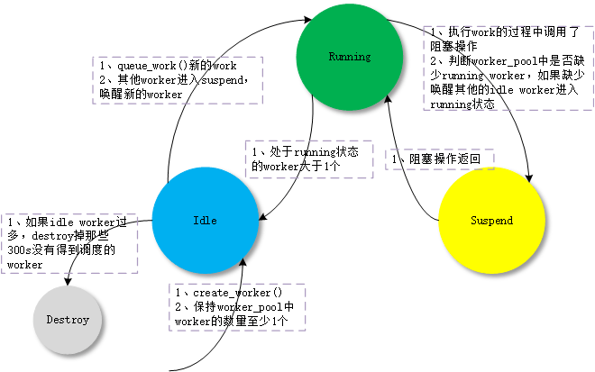
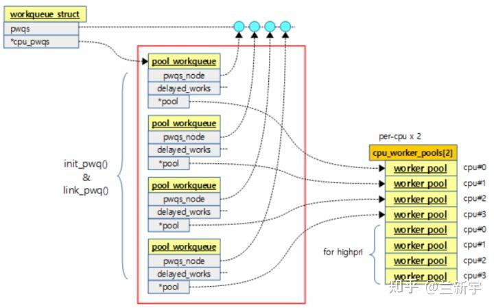

> Introduction for the workqueue of Linux kernel

## 1. BG

workqueue主要是提供一个小型的、方便创建的异步工作环境，user无需创建内核线程便可实现异步效果。相应的，workqueue也是defer interrupt的一种常用方式。

在Kernel最初的workqueue实现中，多线程wq在每个CPU上有一个工作者线程，而单线程 wq在全系统有一个工作者线程。一个MT wq需要保持与CPU数量相同的工 作者数量。这些年来，内核增加了很多MT wq的用户，随着CPU核心数量的不断 增加，一些系统刚启动就达到了默认的32k PID的饱和空间。当前Kernel采用的是并发管理工作队列（**Concurrency Managed Workqueue,** CMWQ），下面是CMWQ的几个元素：

* work ：工作。
* workqueue ：工作的集合。workqueue 和 work 是一对多的关系。
* worker ：工人。在代码中 worker 对应一个 `work_thread()` 内核线程。
* worker\_pool：工人的集合。worker\_pool 和 worker 是一对多的关系。
* pwq(pool\_workqueue)：中间人 / 中介，负责建立起 workqueue 和 worker\_pool 之间的关系。workqueue 和 pwq 是一对多的关系，pwq 和 worker\_pool 是一对一的关系。

下面根据源码具体分析各个元素：

## 2. worker\_pool

执行work的具体action的线程为worker，worker的一组集合即为worker\_pool。CMWQ即根据当前work的负载来动态增减（管理）worker\_pool中worker的数量。CMWQ 对 worker\_pool 分成两类：

1. normal worker\_pool，给通用的 workqueue 使用；
2. unbound worker\_pool，给 WQ\_UNBOUND 类型的的 workqueue 使用；

workqueue子系统模块的init是三段式的：`workqueue_init_early`、`workqueue_init`及`workqueue_init_topology`。本文按照各个元素来剖析workqueue，并不会关注workqueue子系统的加载流程。

### 2.1 normal worker pool

1. `workqueue_init_early`→`init_worker_pool`
2. `workqueue_init`→`create_worker`

`workqueue_init_early`函数会调用`init_worker_pool`来为每个cpu创建两个`worker_pool`，nice值分别为`0`和`HIGHPRI_NICE_LEVEL`

代码如下：

```c
// kernel/workqueue.c
/**
* workqueue_init_early - early init for workqueue subsystem
*
* This is the first step of three-staged workqueue subsystem initialization and
* invoked as soon as the bare basics - memory allocation, cpumasks and idr are
* up. It sets up all the data structures and system workqueues and allows early
* boot code to create workqueues and queue/cancel work items. Actual work item
* execution starts only after kthreads can be created and scheduled right
* before early initcalls.
*/
void __init workqueue_init_early(void)
{
struct wq_pod_type *pt = &wq_pod_types[WQ_AFFN_SYSTEM];
int std_nice[NR_STD_WORKER_POOLS] = { 0, HIGHPRI_NICE_LEVEL };
int i, cpu;
...
/* initialize CPU pools */
for_each_possible_cpu(cpu) {
struct worker_pool *pool;
i = 0;
for_each_cpu_worker_pool(pool, cpu) {
// 创建worker_pool，指定优先级（0和HIGHPRI_NICE_LEVEL）
BUG_ON(init_worker_pool(pool));
pool->cpu = cpu;
cpumask_copy(pool->attrs->cpumask, cpumask_of(cpu));
cpumask_copy(pool->attrs->__pod_cpumask, cpumask_of(cpu));
pool->attrs->nice = std_nice[i++];
pool->attrs->affn_strict = true;
pool->node = cpu_to_node(cpu);
/* alloc pool ID */
mutex_lock(&wq_pool_mutex);
BUG_ON(worker_pool_assign_id(pool));
mutex_unlock(&wq_pool_mutex);
}
}
...
}
```

`init_worker_pool` 是创建worker\_pool的具体实现，比如初始化`work_list`和`idle_list`，创建`idle_worker`超时销毁的timer等。

```c
/**
* init_worker_pool - initialize a newly zalloc'd worker_pool
* @pool: worker_pool to initialize
*
* Initialize a newly zalloc'd @pool. It also allocates @pool->attrs.
*
* Return: 0 on success, -errno on failure. Even on failure, all fields
* inside @pool proper are initialized and put_unbound_pool() can be called
* on @pool safely to release it.
*/
static int init_worker_pool(struct worker_pool *pool)
{
raw_spin_lock_init(&pool->lock);
pool->id = -1;
pool->cpu = -1;
pool->node = NUMA_NO_NODE;
pool->flags |= POOL_DISASSOCIATED;
pool->watchdog_ts = jiffies;
// 各个workqueue将work挂载至该list上，running状态的worker执行
INIT_LIST_HEAD(&pool->worklist);
// worker在完成一个work后，状态变为idle，添加至该list中
INIT_LIST_HEAD(&pool->idle_list);
hash_init(pool->busy_hash);
// 创建超时destroy idle worker的timer
timer_setup(&pool->idle_timer, idle_worker_timeout, TIMER_DEFERRABLE);
INIT_WORK(&pool->idle_cull_work, idle_cull_fn);
timer_setup(&pool->mayday_timer, pool_mayday_timeout, 0);
INIT_LIST_HEAD(&pool->workers);
INIT_LIST_HEAD(&pool->dying_workers);
ida_init(&pool->worker_ida);
INIT_HLIST_NODE(&pool->hash_node);
pool->refcnt = 1;
/* shouldn't fail above this point */
pool->attrs = alloc_workqueue_attrs();
if (!pool->attrs)
return -ENOMEM;
wqattrs_clear_for_pool(pool->attrs);
return 0;
}
```

workqueue init第二阶段会为每个worker\_pool创建一个初始worker

```c
void __init workqueue_init(void)
{
struct workqueue_struct *wq;
struct worker_pool *pool;
int cpu, bkt;
wq_cpu_intensive_thresh_init();
mutex_lock(&wq_pool_mutex);
/*
* Per-cpu pools created earlier could be missing node hint. Fix them
* up. Also, create a rescuer for workqueues that requested it.
*/
for_each_possible_cpu(cpu) {
for_each_cpu_worker_pool(pool, cpu) {
pool->node = cpu_to_node(cpu);
}
}
list_for_each_entry(wq, &workqueues, list) {
WARN(init_rescuer(wq),
"workqueue: failed to create early rescuer for %s",
wq->name);
}
mutex_unlock(&wq_pool_mutex);
/* create the initial workers */
for_each_online_cpu(cpu) {
for_each_cpu_worker_pool(pool, cpu) {
pool->flags &= ~POOL_DISASSOCIATED;
BUG_ON(!create_worker(pool));
}
}
hash_for_each(unbound_pool_hash, bkt, pool, hash_node)
BUG_ON(!create_worker(pool));
wq_online = true;
wq_watchdog_init();
}
|->
static struct worker *create_worker(struct worker_pool *pool)
{
struct worker *worker;
int id;
char id_buf[23];
/* ID is needed to determine kthread name */
id = ida_alloc(&pool->worker_ida, GFP_KERNEL);
if (id < 0) {
pr_err_once("workqueue: Failed to allocate a worker ID: %pe\n",
ERR_PTR(id));
return NULL;
}
worker = alloc_worker(pool->node);
if (!worker) {
pr_err_once("workqueue: Failed to allocate a worker\n");
goto fail;
}
worker->id = id;
// normal和unbound worker内核线程名创建
if (pool->cpu >= 0)
snprintf(id_buf, sizeof(id_buf), "%d:%d%s", pool->cpu, id,
pool->attrs->nice < 0 ? "H" : "");
else
snprintf(id_buf, sizeof(id_buf), "u%d:%d", pool->id, id);
// 在指定NUMA node上创建线程，线程函数为worker_thread
worker->task = kthread_create_on_node(worker_thread, worker, pool->node,
"kworker/%s", id_buf);
if (IS_ERR(worker->task)) {
if (PTR_ERR(worker->task) == -EINTR) {
pr_err("workqueue: Interrupted when creating a worker thread \"kworker/%s\"\n",
id_buf);
} else {
pr_err_once("workqueue: Failed to create a worker thread: %pe",
worker->task);
}
goto fail;
}
// 指定nice值
set_user_nice(worker->task, pool->attrs->nice);
trace_android_rvh_create_worker(worker->task, pool->attrs);
kthread_bind_mask(worker->task, pool_allowed_cpus(pool));
/* successful, attach the worker to the pool attach到worker_pool中 */
worker_attach_to_pool(worker, pool);
/* start the newly created worker */
raw_spin_lock_irq(&pool->lock);
worker->pool->nr_workers++;
worker_enter_idle(worker);
kick_pool(pool);
/*
* @worker is waiting on a completion in kthread() and will trigger hung
* check if not woken up soon. As kick_pool() might not have waken it
* up, wake it up explicitly once more.
*/
wake_up_process(worker->task);
raw_spin_unlock_irq(&pool->lock);
return worker;
fail:
ida_free(&pool->worker_ida, id);
kfree(worker);
return NULL;
}
```

### 2.2 unbounded worker pool

normal worker pool中的worker是与cpu绑定的，Android Linux kernel大部分使用的还是unbound worker pool，schedule\_work()、queue\_work()函数底层均使用的是unbound。

```c
static inline bool queue_work(struct workqueue_struct *wq,
struct work_struct *work)
{
return queue_work_on(WORK_CPU_UNBOUND, wq, work);
}
```

unbound worker\_pool 相对应的意思，就是 worker 可以在多个 CPU 上调度的。但是他其实也是绑定的，只不过它绑定的单位不是 CPU 而是 node。所谓的 node 是对 NUMA(Non Uniform Memory Access Architecture) 系统来说的，NUMA 可能存在多个 node，每个 node 可能包含一个或者多个 CPU。

unbound worker pool可分为两类：

* unbound\_std\_wq\_attrs
* ordered\_wq\_attrs

依旧在第一阶段初始化

```c
void __init workqueue_init_early(void)
{
...
/* create default unbound and ordered wq attrs */
for (i = 0; i < NR_STD_WORKER_POOLS; i++) {
struct workqueue_attrs *attrs;
BUG_ON(!(attrs = alloc_workqueue_attrs()));
attrs->nice = std_nice[i];
unbound_std_wq_attrs[i] = attrs;
/*
* An ordered wq should have only one pwq as ordering is
* guaranteed by max_active which is enforced by pwqs.
*/
BUG_ON(!(attrs = alloc_workqueue_attrs()));
attrs->nice = std_nice[i];
attrs->ordered = true;
ordered_wq_attrs[i] = attrs;
}
...
}
```

剩下的流程没太关注。

## 3. worker

worker即上文中`create_worker`函数创建的内核线程：

```c
worker->task = kthread_create_on_node(worker_thread, worker, pool->node,
"kworker/%s", id_buf);
```

这里分析worker\_thread是怎么执行（处理work），以及CMWQ是怎么管理worker的。

### 3.1 worker\_thread

1. 判断`worker->flags`是否已经被置为`WORKER_DIE` ，然后做detach和free操作（`WORKER_DIE` 是在由timer做的）；
2. `worker_leave_idle` 离开IDLE状态
3. `need_more_worker` 判断当前`worker_pool`上的work\_list是否非空 & `worker_pool`的running task为空；两个条件同时满足，则需要更多worker，否则继续sleep；
4. 随后循环check自身是否需要转为manager（即running），然后assign work到该worker
5. `process_one_work()` 该函数过长
   1. 将该work置为busy
   2. 判断是不是cpu密集型work（`WQ_CPU_INTENSIVE`）；若是，则不能参与CMWQ，且使其成为一个独立的内核线程，并重新判断需不需要more worker（`kick_pool(pool);`）
   3. 执行work的具体函数（`worker->current_func(work);`）

```c
static int worker_thread(void *__worker)
{
struct worker *worker = __worker;
struct worker_pool *pool = worker->pool;
/* tell the scheduler that this is a workqueue worker */
set_pf_worker(true);
woke_up:
raw_spin_lock_irq(&pool->lock);
/* am I supposed to die? */
if (unlikely(worker->flags & WORKER_DIE)) {
raw_spin_unlock_irq(&pool->lock);
set_pf_worker(false);
set_task_comm(worker->task, "kworker/dying");
ida_free(&pool->worker_ida, worker->id);
worker_detach_from_pool(worker);
WARN_ON_ONCE(!list_empty(&worker->entry));
kfree(worker);
return 0;
}
worker_leave_idle(worker);
recheck:
/* no more worker necessary? */
if (!need_more_worker(pool))
goto sleep;
/* do we need to manage? */
if (unlikely(!may_start_working(pool)) && manage_workers(worker))
goto recheck;
/*
* ->scheduled list can only be filled while a worker is
* preparing to process a work or actually processing it.
* Make sure nobody diddled with it while I was sleeping.
*/
WARN_ON_ONCE(!list_empty(&worker->scheduled));
/*
* Finish PREP stage. We're guaranteed to have at least one idle
* worker or that someone else has already assumed the manager
* role. This is where @worker starts participating in concurrency
* management if applicable and concurrency management is restored
* after being rebound. See rebind_workers() for details.
*/
worker_clr_flags(worker, WORKER_PREP | WORKER_REBOUND);
do {
struct work_struct *work =
list_first_entry(&pool->worklist,
struct work_struct, entry);
if (assign_work(work, worker, NULL))
process_scheduled_works(worker);
} while (keep_working(pool));
worker_set_flags(worker, WORKER_PREP);
sleep:
/*
* pool->lock is held and there's no work to process and no need to
* manage, sleep. Workers are woken up only while holding
* pool->lock or from local cpu, so setting the current state
* before releasing pool->lock is enough to prevent losing any
* event.
*/
worker_enter_idle(worker);
__set_current_state(TASK_IDLE);
raw_spin_unlock_irq(&pool->lock);
schedule();
goto woke_up;
}
|->
static void process_scheduled_works(struct worker *worker)
{
struct work_struct *work;
bool first = true;
while ((work = list_first_entry_or_null(&worker->scheduled,
struct work_struct, entry))) {
if (first) {
worker->pool->watchdog_ts = jiffies;
first = false;
}
process_one_work(worker, work);
}
}
||->
static void process_one_work(struct worker *worker, struct work_struct *work)
__releases(&pool->lock)
__acquires(&pool->lock)
{
struct pool_workqueue *pwq = get_work_pwq(work);
struct worker_pool *pool = worker->pool;
unsigned long work_data;
#ifdef CONFIG_LOCKDEP
/*
* It is permissible to free the struct work_struct from
* inside the function that is called from it, this we need to
* take into account for lockdep too. To avoid bogus "held
* lock freed" warnings as well as problems when looking into
* work->lockdep_map, make a copy and use that here.
*/
struct lockdep_map lockdep_map;
lockdep_copy_map(&lockdep_map, &work->lockdep_map);
#endif
/* ensure we're on the correct CPU */
WARN_ON_ONCE(!(pool->flags & POOL_DISASSOCIATED) &&
raw_smp_processor_id() != pool->cpu);
/* claim and dequeue */
debug_work_deactivate(work);
hash_add(pool->busy_hash, &worker->hentry, (unsigned long)work);
worker->current_work = work;
worker->current_func = work->func;
worker->current_pwq = pwq;
worker->current_at = worker->task->se.sum_exec_runtime;
work_data = *work_data_bits(work);
worker->current_color = get_work_color(work_data);
/*
* Record wq name for cmdline and debug reporting, may get
* overridden through set_worker_desc().
*/
strscpy(worker->desc, pwq->wq->name, WORKER_DESC_LEN);
list_del_init(&work->entry);
/*
* CPU intensive works don't participate in concurrency management.
* They're the scheduler's responsibility. This takes @worker out
* of concurrency management and the next code block will chain
* execution of the pending work items.
*/
if (unlikely(pwq->wq->flags & WQ_CPU_INTENSIVE))
worker_set_flags(worker, WORKER_CPU_INTENSIVE);
/*
* Kick @pool if necessary. It's always noop for per-cpu worker pools
* since nr_running would always be >= 1 at this point. This is used to
* chain execution of the pending work items for WORKER_NOT_RUNNING
* workers such as the UNBOUND and CPU_INTENSIVE ones.
*/
kick_pool(pool);
/*
* Record the last pool and clear PENDING which should be the last
* update to @work. Also, do this inside @pool->lock so that
* PENDING and queued state changes happen together while IRQ is
* disabled.
*/
set_work_pool_and_clear_pending(work, pool->id);
pwq->stats[PWQ_STAT_STARTED]++;
raw_spin_unlock_irq(&pool->lock);
lock_map_acquire(&pwq->wq->lockdep_map);
lock_map_acquire(&lockdep_map);
/*
* Strictly speaking we should mark the invariant state without holding
* any locks, that is, before these two lock_map_acquire()'s.
*
* However, that would result in:
*
* A(W1)
* WFC(C)
* A(W1)
* C(C)
*
* Which would create W1->C->W1 dependencies, even though there is no
* actual deadlock possible. There are two solutions, using a
* read-recursive acquire on the work(queue) 'locks', but this will then
* hit the lockdep limitation on recursive locks, or simply discard
* these locks.
*
* AFAICT there is no possible deadlock scenario between the
* flush_work() and complete() primitives (except for single-threaded
* workqueues), so hiding them isn't a problem.
*/
lockdep_invariant_state(true);
trace_workqueue_execute_start(work);
worker->current_func(work);
/*
* While we must be careful to not use "work" after this, the trace
* point will only record its address.
*/
trace_workqueue_execute_end(work, worker->current_func);
pwq->stats[PWQ_STAT_COMPLETED]++;
lock_map_release(&lockdep_map);
lock_map_release(&pwq->wq->lockdep_map);
if (unlikely(in_atomic() || lockdep_depth(current) > 0 ||
rcu_preempt_depth() > 0)) {
pr_err("BUG: workqueue leaked lock or atomic: %s/0x%08x/%d/%d\n"
" last function: %ps\n",
current->comm, preempt_count(), rcu_preempt_depth(),
task_pid_nr(current), worker->current_func);
debug_show_held_locks(current);
dump_stack();
}
/*
* The following prevents a kworker from hogging CPU on !PREEMPTION
* kernels, where a requeueing work item waiting for something to
* happen could deadlock with stop_machine as such work item could
* indefinitely requeue itself while all other CPUs are trapped in
* stop_machine. At the same time, report a quiescent RCU state so
* the same condition doesn't freeze RCU.
*/
cond_resched();
raw_spin_lock_irq(&pool->lock);
/*
* In addition to %WQ_CPU_INTENSIVE, @worker may also have been marked
* CPU intensive by wq_worker_tick() if @work hogged CPU longer than
* wq_cpu_intensive_thresh_us. Clear it.
*/
worker_clr_flags(worker, WORKER_CPU_INTENSIVE);
/* tag the worker for identification in schedule() */
worker->last_func = worker->current_func;
/* we're done with it, release */
hash_del(&worker->hentry);
worker->current_work = NULL;
worker->current_func = NULL;
worker->current_pwq = NULL;
worker->current_color = INT_MAX;
pwq_dec_nr_in_flight(pwq, work_data);
}
```

### 3.2 CMWQ

CMWQ的主要思想如下：

* worker\_pool 中的 worker 有 3 种状态：idle、running、suspend；
* 如果 worker\_pool 中有 work 需要处理，保持至少一个 running worker 来处理；
* running worker 在处理 work 的过程中进入了阻塞 suspend 状态，为了保持其他 work 的执行，需要唤醒新的 idle worker 来处理 work；
* 如果有 work 需要执行且 running worker 大于 1 个，会让多余的 running worker 进入 idle 状态；
* 如果没有 work 需要执行，会让所有 worker 进入 idle 状态；
* 如果创建的 worker 过多，destroy\_worker 在 300s(IDLE\_WORKER\_TIMEOUT) 时间内没有再次运行的 idle worker。



## 4 workqueue

workqueue 就是存放一组 work 的集合，基本可以分为两类：一类系统创建的 workqueue，一类是用户自己创建的 workqueue。

**系统创建的wq如下：**

大致可以分为三类：

1. 普通的
2. 高优先级的
3. unbound的

```c
void __init workqueue_init_early(void)
{
...
system_wq = alloc_workqueue("events", 0, 0);
system_highpri_wq = alloc_workqueue("events_highpri", WQ_HIGHPRI, 0);
system_long_wq = alloc_workqueue("events_long", 0, 0);
system_unbound_wq = alloc_workqueue("events_unbound", WQ_UNBOUND,
WQ_MAX_ACTIVE);
system_freezable_wq = alloc_workqueue("events_freezable",
WQ_FREEZABLE, 0);
system_power_efficient_wq = alloc_workqueue("events_power_efficient",
WQ_POWER_EFFICIENT, 0);
system_freezable_power_efficient_wq = alloc_workqueue("events_freezable_power_efficient",
WQ_FREEZABLE | WQ_POWER_EFFICIENT,
0);
BUG_ON(!system_wq || !system_highpri_wq || !system_long_wq ||
!system_unbound_wq || !system_freezable_wq ||
!system_power_efficient_wq ||
!system_freezable_power_efficient_wq);
}
```

**创建workqueue的接口为`alloc_workqueue`**

这里需要注意pool\_workqueues；一个系统至少存在几十个 workqueues，“插入”一个 workqueue 的 work 可能在不同的 CPU 上运行（一般执行一个 work 的 CPU 都是将该 work 插入 wq 的线程所在的 CPU），而一个 CPU 的两个 worker pool 里处理的 work 也可能来自不同的 workqueue。

workqueue 和 CPU 实际形成了一种“**多对多**”的关系，为此创建了一个名为\*\*\*"pool\_workqueue\*"\*\* 的结构体（简称 pwq）来连接这两者（可理解为一个 workqueue 在一个 CPU 上的代理，如果有 50 个 workqueues，4 个CPU，那么就有 200 个 pwq）：



一个`workqueue_struct`中会维护与cpu个数相同的pwqs，具体的函数为`alloc_and_link_pwqs`

```c
static int alloc_and_link_pwqs(struct workqueue_struct *wq)
{
bool highpri = wq->flags & WQ_HIGHPRI;
int cpu, ret;
bool skip = false;
wq->cpu_pwq = alloc_percpu(struct pool_workqueue *);
if (!wq->cpu_pwq)
goto enomem;
// 为每个cpu创建pwqs，并于workqueue建立联系（init_wq）
if (!(wq->flags & WQ_UNBOUND)) {
for_each_possible_cpu(cpu) {
struct pool_workqueue **pwq_p =
per_cpu_ptr(wq->cpu_pwq, cpu);
struct worker_pool *pool =
&(per_cpu_ptr(cpu_worker_pools, cpu)[highpri]);
*pwq_p = kmem_cache_alloc_node(pwq_cache, GFP_KERNEL,
pool->node);
if (!*pwq_p)
goto enomem;
init_pwq(*pwq_p, wq, pool);
mutex_lock(&wq->mutex);
link_pwq(*pwq_p);
mutex_unlock(&wq->mutex);
}
return 0;
}
trace_android_rvh_alloc_and_link_pwqs(wq, &ret, &skip);
if (skip)
goto oem_skip;
cpus_read_lock();
if (wq->flags & __WQ_ORDERED) {
ret = apply_workqueue_attrs(wq, ordered_wq_attrs[highpri]);
/* there should only be single pwq for ordering guarantee */
WARN(!ret && (wq->pwqs.next != &wq->dfl_pwq->pwqs_node ||
wq->pwqs.prev != &wq->dfl_pwq->pwqs_node),
"ordering guarantee broken for workqueue %s\n", wq->name);
} else {
ret = apply_workqueue_attrs(wq, unbound_std_wq_attrs[highpri]);
}
cpus_read_unlock();
oem_skip:
/* for unbound pwq, flush the pwq_release_worker ensures that the
* pwq_release_workfn() completes before calling kfree(wq).
*/
if (ret)
kthread_flush_worker(pwq_release_worker);
return ret;
enomem:
if (wq->cpu_pwq) {
for_each_possible_cpu(cpu) {
struct pool_workqueue *pwq = *per_cpu_ptr(wq->cpu_pwq, cpu);
if (pwq)
kmem_cache_free(pwq_cache, pwq);
}
free_percpu(wq->cpu_pwq);
wq->cpu_pwq = NULL;
}
return -ENOMEM;
}
```

## 5 work

work的创建并没什么好说的，使用`INIT_WORK`宏初始化work的func即可，然后调用`queue_work`或者`schedule_work` 将work压入到workqueue中。

最终调用的函数为`__queue_work()` ，将work填充到worker pool的work\_list中，待worker执行。

```c
static void __queue_work(int cpu, struct workqueue_struct *wq,
struct work_struct *work)
{
struct pool_workqueue *pwq;
struct worker_pool *last_pool, *pool;
unsigned int work_flags;
unsigned int req_cpu = cpu;
/*
* While a work item is PENDING && off queue, a task trying to
* steal the PENDING will busy-loop waiting for it to either get
* queued or lose PENDING. Grabbing PENDING and queueing should
* happen with IRQ disabled.
*/
lockdep_assert_irqs_disabled();
/*
* For a draining wq, only works from the same workqueue are
* allowed. The __WQ_DESTROYING helps to spot the issue that
* queues a new work item to a wq after destroy_workqueue(wq).
*/
if (unlikely(wq->flags & (__WQ_DESTROYING | __WQ_DRAINING) &&
WARN_ON_ONCE(!is_chained_work(wq))))
return;
rcu_read_lock();
retry:
/* pwq which will be used unless @work is executing elsewhere */
if (req_cpu == WORK_CPU_UNBOUND) {
if (wq->flags & WQ_UNBOUND)
cpu = wq_select_unbound_cpu(raw_smp_processor_id());
else
cpu = raw_smp_processor_id();
}
pwq = rcu_dereference(*per_cpu_ptr(wq->cpu_pwq, cpu));
pool = pwq->pool;
/*
* If @work was previously on a different pool, it might still be
* running there, in which case the work needs to be queued on that
* pool to guarantee non-reentrancy.
*/
last_pool = get_work_pool(work);
if (last_pool && last_pool != pool) {
struct worker *worker;
raw_spin_lock(&last_pool->lock);
worker = find_worker_executing_work(last_pool, work);
if (worker && worker->current_pwq->wq == wq) {
pwq = worker->current_pwq;
pool = pwq->pool;
WARN_ON_ONCE(pool != last_pool);
} else {
/* meh... not running there, queue here */
raw_spin_unlock(&last_pool->lock);
raw_spin_lock(&pool->lock);
}
} else {
raw_spin_lock(&pool->lock);
}
/*
* pwq is determined and locked. For unbound pools, we could have raced
* with pwq release and it could already be dead. If its refcnt is zero,
* repeat pwq selection. Note that unbound pwqs never die without
* another pwq replacing it in cpu_pwq or while work items are executing
* on it, so the retrying is guaranteed to make forward-progress.
*/
if (unlikely(!pwq->refcnt)) {
if (wq->flags & WQ_UNBOUND) {
raw_spin_unlock(&pool->lock);
cpu_relax();
goto retry;
}
/* oops */
WARN_ONCE(true, "workqueue: per-cpu pwq for %s on cpu%d has 0 refcnt",
wq->name, cpu);
}
/* pwq determined, queue */
trace_workqueue_queue_work(req_cpu, pwq, work);
trace_android_vh_wq_queue_work(work, wq->name, wq->flags, cpu);
if (WARN_ON(!list_empty(&work->entry)))
goto out;
pwq->nr_in_flight[pwq->work_color]++;
work_flags = work_color_to_flags(pwq->work_color);
if (likely(pwq->nr_active < pwq->max_active)) {
if (list_empty(&pool->worklist))
pool->watchdog_ts = jiffies;
trace_workqueue_activate_work(work);
pwq->nr_active++;
insert_work(pwq, work, &pool->worklist, work_flags);
kick_pool(pool);
} else {
work_flags |= WORK_STRUCT_INACTIVE;
insert_work(pwq, work, &pwq->inactive_works, work_flags);
}
out:
raw_spin_unlock(&pool->lock);
rcu_read_unlock();
}
```

因此，使用`alloc_workqueue()`创建自己的workqueue并不能拥有比系统workqueue更高的优先级，只是为了提供更精细或者定制的行为配置，比如：

1. 设置并发度`max_actions`
2. 设置flags（绑定至某个cpu、优先级、是否在suspend时被freeze等）

## 6 Reference

* https://www.kernel.org/doc/html/latest/core-api/workqueue.html
* https://kernel.meizu.com/2016/08/21//linux-workqueue.html/
* https://zhuanlan.zhihu.com/p/91106844
