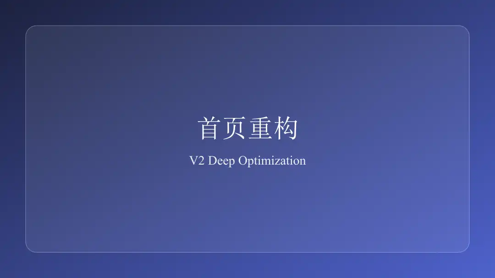
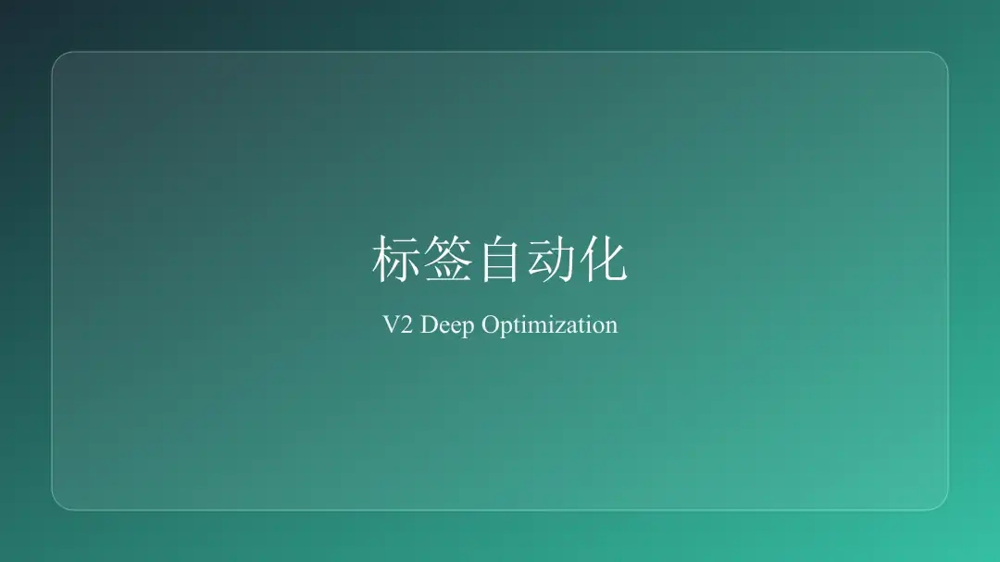
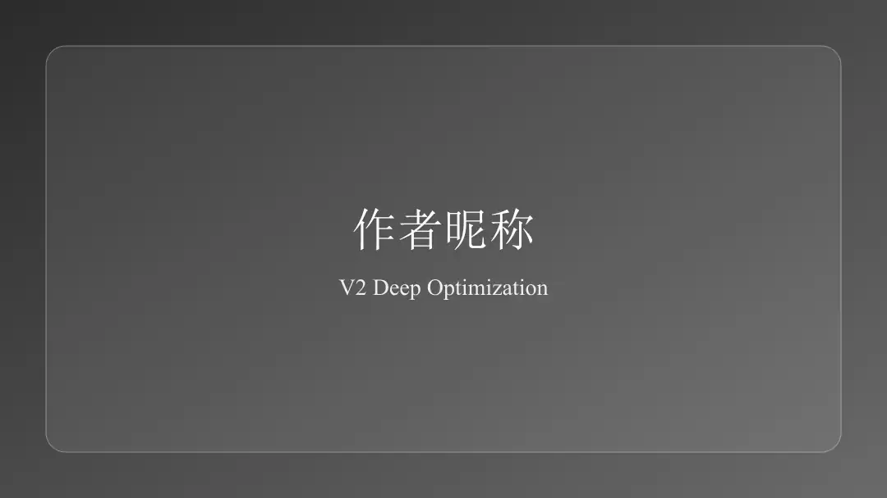
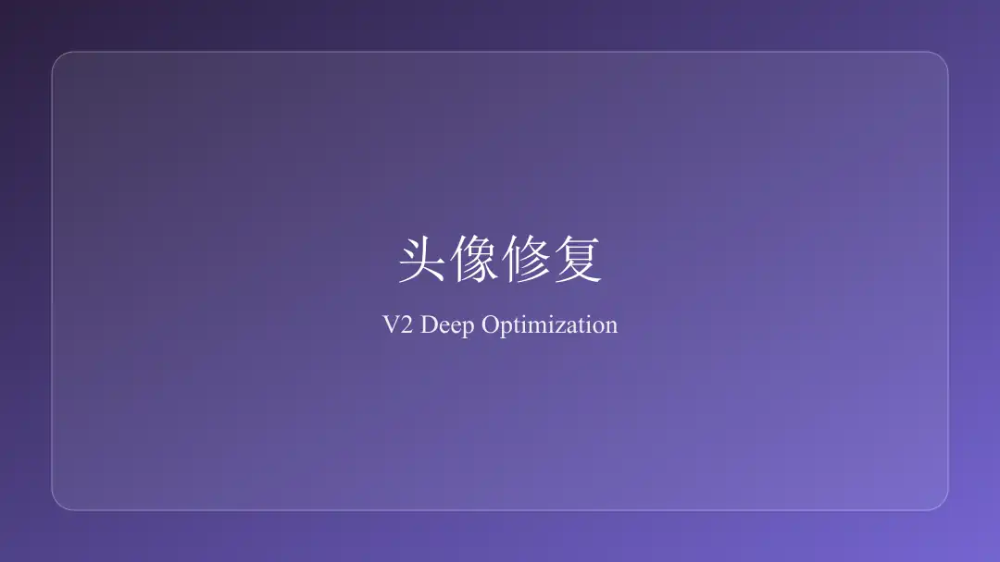
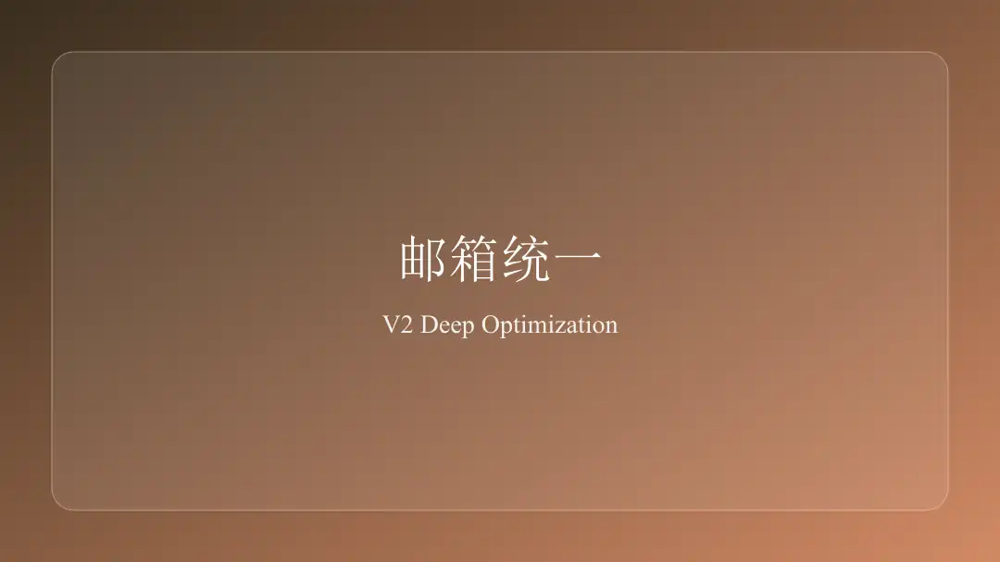
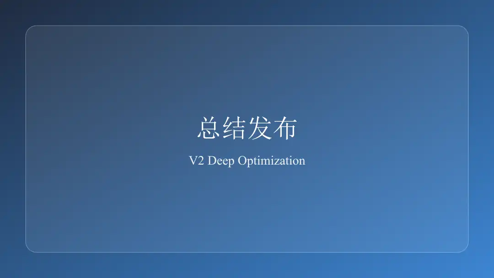

## ① 项目背景与目标

本轮目标是把博客从“主题改色”提升到“结构、数据、交互、发布流程”协同优化。核心原则是可配置、可维护、可持续迭代，并确保桌面端与移动端表现一致。

## ② 六项优化逐项拆解

### 1) 主页文章展示重构

* 首页改为仅展示标题与摘要，移除全文渲染
* 摘要优先读取 front-matter `excerpt`，为空时自动抽取正文前 140 字并补 `…`
* 卡片改为双栏布局，hover 上浮 4 px，阴影过渡 0.2 s ease-out

```js
const fmExcerpt = clampExcerpt(fmData.excerpt);
const fallback = autoExcerpt(stripHtml(post.content));
post.brief = fmExcerpt || fallback;
```



### 2) 标签体系自动化

* 构建前扫描 `content/posts` 与 `source/_posts`
* 统一归一化：小写 + 空格转连字符
* 生成 `data/tags.json` 与 `source/_data/tags.json`
* 菜单动态标签云字体按 12–24 px 线性映射

```js
const ratio = max === min ? 0.5 : (count - min) / (max - min);
const size = 12 + ratio * 12;
```



### 3) 右上角作者名称优化

* 移除“Bevis Wang”固定写法
* 新增 `config/site.js` 的 `author.nick` 配置
* 右上角作者徽标使用 18 px、字重 500，hover 过渡主题色

```js
const nick = runtimeConfig.author && runtimeConfig.author.nick ? runtimeConfig.author.nick : '';
```



### 4) wangbi 头像修复

* 定位故障：外链 `img.picui.cn` DNS 不可达，导致头像加载失败
* 转本地资源 `/images/avatar.webp`，并提供 `/images/avatar-fallback.svg` 兜底
* 增加 `loading="lazy"`、`decoding="async"` 与固定边框，避免抖动

```html

```



### 5) 重复 email 清理

* 清理主题与站点配置中的重复邮箱入口
* 统一只保留 `config/site.js` 的 `social.email`
* 模板统一读取 `siteConfig.social.email`



### 6) 优化总结文章与发布链路

* 新增本文并接入 `npm run lint:text` 进行文本与外链检查
* 发布前执行构建验证并输出可预览结果



## ③ 踩坑记录与解决方案

* `img.picui.cn` 无法解析：改为本地头像 + fallback SVG
* 标签来源不一致：扫描目录扩展为 `content/posts` 与 `source/_posts`
* 顶部标签云字号离散过大：改用线性映射并加下限上限

## ④ 后续迭代计划

* 补齐真实 Lighthouse 前后基线自动采样并纳入 CI
* 将标签云交互升级为按时间与分类联合过滤
* 为首页卡片加入按阅读时长分层视觉提示

参考：

* https://hexo.io/docs/data-files
* https://hexo.io/docs/variables
