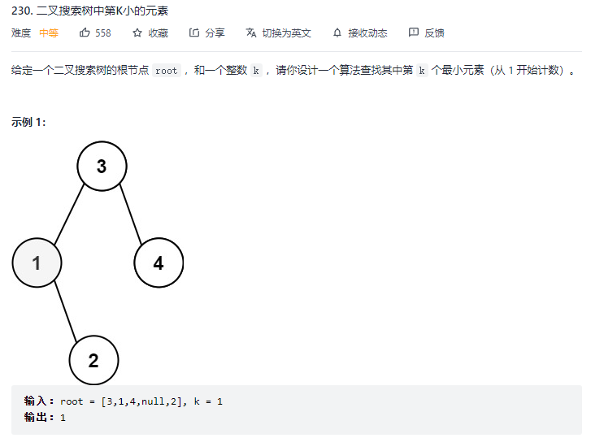
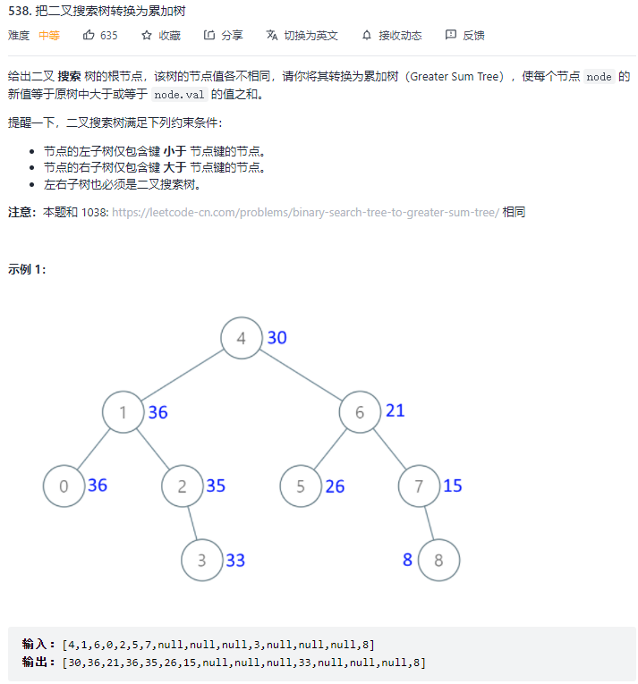

### 文章对应的题目
230  BST第K小的元素
538  二叉搜索树转化为累加树


***

### 二叉搜索树BST特性：
1、对于BST上每个节点`node`，左子树的节点的值都比`node`的值要小，右子树节点的值都比`node`的值要大。
2、对于BST的每一个节点`node`，他的左侧子树`node -> left`和右侧子树`node -> right`都为BST。
3、对BST做**中序遍历**，得到的遍历结果是**升序**的。
```cpp
//对BST做中序遍历
void traverse(TreeNode* root) {
    if(root == nullptr)  return;
    traverse(root -> left);
    cout << root -> val << endl;
    traverse(root -> right);
    return;
}
```

***

# 230. 寻找第K小的元素

题目需求如上，直接思路就是中序遍历，找到排名第K的元素，代码如下。
```cpp
/**
 * Definition for a binary tree node.
 * struct TreeNode {
 *     int val;
 *     TreeNode *left;
 *     TreeNode *right;
 *     TreeNode() : val(0), left(nullptr), right(nullptr) {}
 *     TreeNode(int x) : val(x), left(nullptr), right(nullptr) {}
 *     TreeNode(int x, TreeNode *left, TreeNode *right) : val(x), left(left), right(right) {}
 * };
 */
class Solution {
    int res= 0;
    int i = 0;
public:
    int kthSmallest(TreeNode* root, int k) {
        traverse(root, k);
        return res;
    }
    void traverse(TreeNode* root, int k) {
        if(root == nullptr) {  
            return;
        }
        traverse(root -> left, k);
        i++;
        if(i == k) {
            res = root -> val;
            return;
        }
        traverse(root -> right, k);
    }
};
```
时间复杂度为`O(N)`，像红黑树这种自平衡的BST，增删查改时间复杂度都是对数级的`O(logN)`，所以说有点低效。
若要达到对数级的时间复杂度，就需要知道当前的节点的排名是多少（类似于二分查找）。
比如说你让我查找排名为k的元素，当前节点知道自己排名第`m`，那么我可以比较`m`和`k`的大小：

1、如果`m == k`，显然就是找到了第`k`个元素，返回当前节点就行了。
2、如果`k < m`，那说明排名第k的元素在左子树，所以可以去左子树搜索第`k`个元素。
3、如果`k > m`，那说明排名第k的元素在右子树，所以可以去右子树搜索第`k - m - 1`个元素。

这样就可以将时间复杂度降到`O(logN)`了。这就需要在二叉树节点中维护一个排名信息：
```cpp
struct TreeNode {
     int val;
     //size为当前节点为根节点的树的节点总数
     int size;
     TreeNode *left;
     TreeNode *right;
     TreeNode() : val(0), left(nullptr), right(nullptr) {}
     TreeNode(int x) : val(x), left(nullptr), right(nullptr) {}
     TreeNode(int x, TreeNode *left, TreeNode *right) : val(x), left(left), right(right) {}
 };
```
这样就可以将排名`k`和`node -> left -> size`对比，达到对数级的时间复杂度。

***

### 二叉搜索树转化为累加树

其实就是利用二叉树的中序遍历特性，本题直接利用降序输出即可，递归顺序为：

```cpp
void traverse(TreeNode* root) {
    if(root == nullprt)
        return;
    traverse(root -> right);
    cout << root -> val << endl;
    traverse(root -> left);
}
```
这段代码可以从大到小降序打印 BST 节点的值，如果维护一个外部累加变量`sum`，然后把`sum`赋值给 BST 中的每一个节点，就可以将 BST 转化成累加树。代码如下：
```cpp
/**
 * Definition for a binary tree node.
 * struct TreeNode {
 *     int val;
 *     TreeNode *left;
 *     TreeNode *right;
 *     TreeNode() : val(0), left(nullptr), right(nullptr) {}
 *     TreeNode(int x) : val(x), left(nullptr), right(nullptr) {}
 *     TreeNode(int x, TreeNode *left, TreeNode *right) : val(x), left(left), right(right) {}
 * };
 */
class Solution {
public:
    int sum = 0;
    TreeNode* convertBST(TreeNode* root) {
        GST(root);
        return root;
    }
    void GST(TreeNode* root) {
        if(root == nullptr)
            return;
        GST(root -> right);
        sum += root -> val;
        root -> val = sum;
        GST(root -> left);
        return;
    }
};
```
[labuladong公众号]([手把手刷二叉搜索树（第一期） (qq.com)](https://mp.weixin.qq.com/s?__biz=MzAxODQxMDM0Mw==&mid=2247488101&idx=1&sn=6041ddda5f20ccde8a7036d3e3a1482c&chksm=9bd7ec6daca0657b2ab20a936437e2c8206384c3b1485fe91747ad796fa3a5b08556b2f4911e&scene=21#wechat_redirect))
